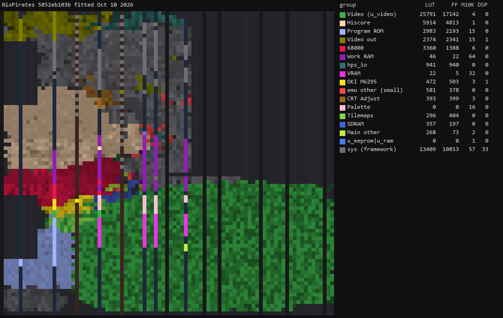

# NIX Pirates hardware core for MiSTer

A MiSTer FPGA core for NIX's Pirates hardware (MAME's `nix/pirates.cpp`), built with Quartus
Prime 17.0.2 Lite for the DE10-nano.

**Status: Released** `releases/Arcade-NixPirates_20261010.rbf` (commit `5852eb1`, default
fitter seed) boots and plays as well as MAME. These games came from a little-known Spanish developer and the boards are rare/non-existent.

## Games

| Set | Game | Year | `.mra` | On hardware |
|-|-|-|-|-|
| `genix` | Genix Family | 1994 | `releases/` | in-game |
| `pirates` | Pirates (set 1) | 1994 | `releases/` | in-game |
| `piratesb` | Pirates (set 2) | 1995 | `releases/_alternatives/_Pirates/` | in-game |

ROM sets as MAME 0.289.

## Installation

Needs an SDRAM module.

* Copy `releases/Arcade-NixPirates_20261010.rbf` to `_Arcade/cores/`, renamed
  `NixPirates_20261010.rbf`.
* Copy the `.mra` files and the `_alternatives` folder from `releases/` to `_Arcade/`.
* Put the MAME ROM sets (`pirates.zip`, `genix.zip`) in `games/mame/`.

## Controls

Three buttons, Start and Coin per player: Shoot, Slide, Bomb in Pirates; Button A, Button B,
Special in Genix Family. Pause and Service can be mapped to joystick buttons.

## Hardware

| Chip | Implementation |
|-|-|
| MC68000, 16 MHz | fx68k |
| OKI M6295, 1.333 MHz | jt6295 |
| 93C46 EEPROM | jt9346 |
| Tilemaps, sprites, palette | written for this core (`rtl/np_video.sv`) |
| ROMs | SDRAM through `jtframe_sdram64` |

### Floorplan

Where the logic sits on the Cyclone V, read from the compiled design with `scripts/floorplan.py` (blocks defined in `scripts/floorplan.json`). One cell per LAB, M10K or DSP site, coloured by the block owning most of it, brighter when fuller. The thin columns are M10K and DSP; the empty area at the top right is the HPS; grey is the MiSTer framework. LUT counts are combinational cells, two per ALM.

Revision `NixPirates`, fitted 10 Oct 2026:

## Building

`python scripts/build_staged.py --rev NixPirates`, then `python scripts/deploy.py` with a
`mister.env`. `docs/ROADMAP.md` is the plan and its progress.

## AI Attestation

This core is being developed with heavy use of a frontier coding assistant.

## Acknowledgements

- David Haywood, Nicola Salmoria and Paul Priest, and the MAMEdev team, for `pirates.cpp`.
- Jorge Cwik for fx68k; Jose Tejada Gomez for jtframe, JT6295 and jteeprom; Alan Steremberg and
  Jim Gregory for the hiscore module; rmonic79 for CRT adjust; Sorgelig and the MiSTer-devel team
  for Template_MiSTer.

## License

GPL-3.0-or-later (`LICENSE`). Third-party components and their licences: `THIRD-PARTY.md`.
